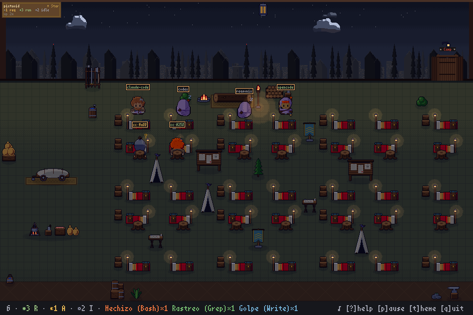
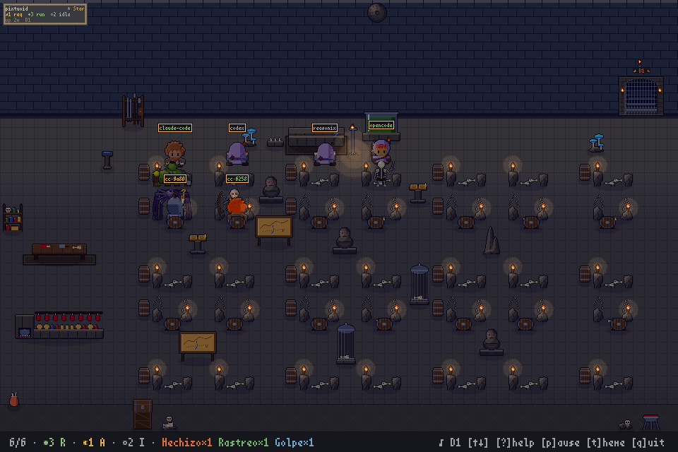

# Dungeons & Agents

*[English](README.md)*

**Dungeons & Agents** es una reinterpretación original, en clave de fantasía
oscura, de [Pixtuoid](https://github.com/pixtuoid/pixtuoid), la oficina en pixel
art para agentes de programación con IA. Cada sesión de agente (Claude Code,
Codex, OpenCode y los demás CLI que admite Pixtuoid) es un aventurero: descansa
en un campamento nocturno mientras está inactiva y baja a la mazmorra a combatir
mientras trabaja.

## Qué trae

- **Campamento y mazmorras.** La planta 0 es un campamento al aire libre donde
  descansan los agentes inactivos; las plantas D1, D2... son mazmorras de piedra
  donde trabajan.
- **Monstruos mientras trabajan.** Cada guarida muestra su monstruo (orco,
  goblins, esqueletos, araña gigante) solo mientras su aventurero trabaja.
- **Cuatro clases**, según el rol de la sesión en Orca: caballero
  (orquestador), mago (companion), montaraz (subagente o sesión suelta) y
  berserker (worker). La túnica, el manto o la capa llevan el color del equipo.
- **Habilidades.** Cada herramienta se muestra como habilidad junto a su nombre:
  `Hechizo (Bash)`, y las llamadas a la CLI de Orca como `Hechizo (Orca)`.
- **Mascotas:** un osolechuza, un lobo gris y un cuervo.

## Instalación

Se publica como *release* de este repositorio: un zip para Windows y su SHA-256.
El adaptador [Pixtuoid para Orca](https://github.com/icaceresc/pixtuoid-orca-windows)
lo descarga en su modo `dungeon` y verifica la suma; sigue su README. Los
ejecutables conservan los nombres `pixtuoid.exe` y `pixtuoid-hook.exe`, que el
instalador y los hooks esperan.

Sin Orca: descomprime el zip y ejecuta `.\pixtuoid.exe setup` y luego
`.\pixtuoid.exe floating`. Para compilar desde el código fuente, consulta el
[README en inglés](README.md#build-from-source).

## Créditos y licencia

Basado en [Pixtuoid](https://github.com/pixtuoid/pixtuoid) de Ivan Wang, con
licencia MIT; este fork conserva esa licencia y su aviso de copyright
([LICENSE](LICENSE)).

Dungeons & Agents es un proyecto independiente de fans. No está afiliado a
Wizards of the Coast, Larian Studios ni al proyecto Pixtuoid, ni cuenta con su
respaldo o patrocinio.
