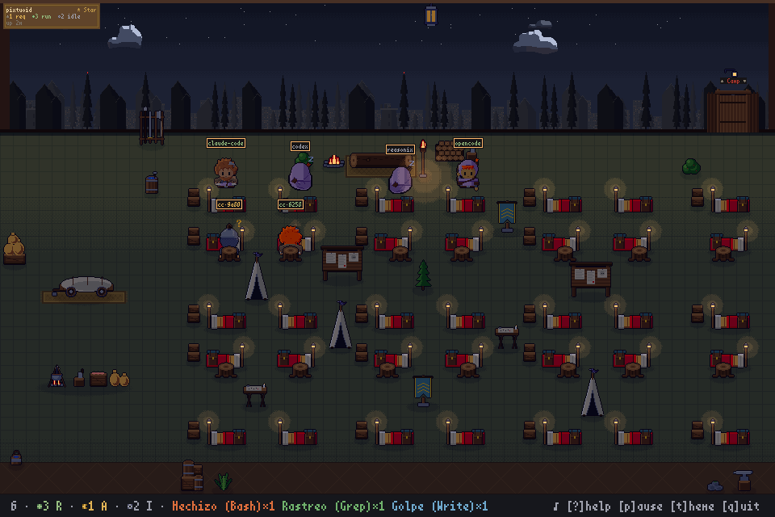
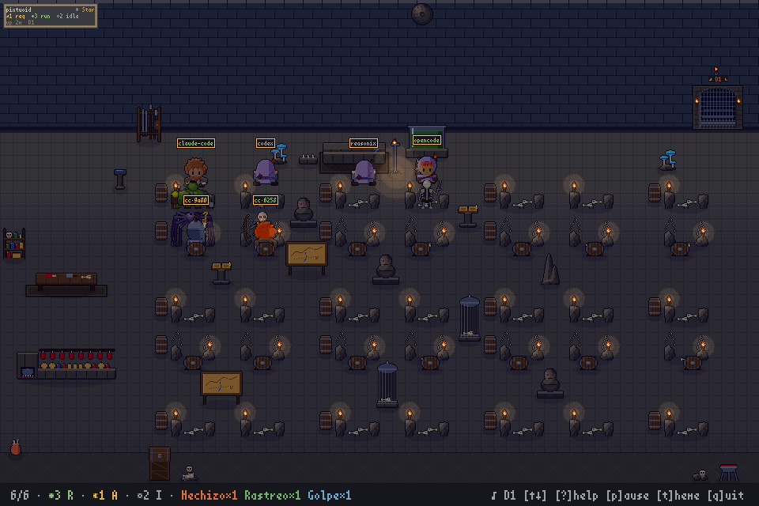
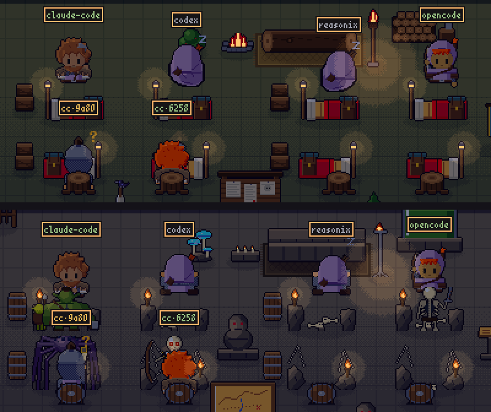

# Dungeons & Agents

*[Español](README.es.md)*

**Dungeons & Agents** is an original dark-fantasy campaign reskin of
[Pixtuoid](https://github.com/pixtuoid/pixtuoid), the pixel-art office for AI
coding agents. Every agent session you run (Claude Code, Codex, OpenCode and the
other CLIs Pixtuoid supports) becomes an adventurer: it rests at a night camp
while it is idle and goes down into the dungeon to fight while it works.







## What changes from Pixtuoid

- **Camp and dungeon floors.** Floor 0 is an open-air night camp with tents,
  bedrolls, log stumps and a campfire, where idle and finished agents rest.
  The floors below (D1, D2...) are stone dungeons where working agents take a
  seat in a lair. The footer and the floor indicator read `Camp`, `D1`, `D2`.
- **Monsters while agents work.** A lair holds its monster only while its
  adventurer is working: an orc with a goblin, a pair of goblins, a skeleton
  warrior, a giant spider or a skeleton archer, different from desk to desk.
  An idle agent's lair stands empty.
- **Four classes.** Each class has its own look and its own attack, played
  where an office worker would type. In an Orca office the class follows the
  session's role; any other session gets a stable class from its id.

  | Class | Look | Orca role |
  |---|---|---|
  | Knight | open iron helm, mail, tabard | orchestrator |
  | Mage | deep hood, mantle, long robe | companion |
  | Ranger | hood, short cape, quiver | subagent or lone session |
  | Berserker | wild mane, fur pelt, bandaged arms | worker |

  The tabard, robe or cape takes the agent's team colour, as Pixtuoid's shirts
  do, so a party reads at a glance.
- **Skills.** A running tool is named as a skill, with the tool beside it, in
  the footer, the tooltip and the dashboard: `Hechizo (Bash)`.

  | Skill | Tools |
  |---|---|
  | Hechizo (spell) | shell commands, and Orca CLI calls: `Hechizo (Orca)` |
  | Golpe (strike) | file edits and writes |
  | Estudio (study) | file reads and listings |
  | Rastreo (tracking) | code search |
  | Exploración (scouting) | web fetch and search |
  | Invocación (summoning) | subagents |
  | Táctica (tactics) | plans and to-do lists |
  | Ritual | MCP tools |
  | Habilidad (skill) | any other tool |

- **Pets.** An owlbear, a grey wolf and a raven roam the floors.
- **The look.** A `dark-fantasy` theme is the default, the window title reads
  *Dungeons & Agents*, and all art is original, drawn by
  [`scripts/gen-art.py`](scripts/gen-art.py).

Everything else (the supported agent CLIs, the hooks, the configuration and the
privacy model) is Pixtuoid's; see [Upstream documentation](#upstream-documentation).

## Install with Orca on Windows

Dungeons & Agents is published as a release of this repository: a Windows zip
(`dungeons-and-agents-v<version>-x86_64-pc-windows-msvc.zip`) and its SHA-256.
The [Pixtuoid para Orca](https://github.com/icaceresc/pixtuoid-orca-windows)
adapter downloads it in its `dungeon` mode, verifies the checksum and connects
the agents Orca runs; follow that repository's README for the exact steps.

The executables keep Pixtuoid's names, `pixtuoid.exe` and `pixtuoid-hook.exe`,
because the adapter's installer and the agent hooks expect them. They also use
Pixtuoid's configuration and log folders.

## Standalone

Unzip the release anywhere, then, from that folder:

```powershell
.\pixtuoid.exe setup      # detect your agent CLIs and connect them (installs their hooks)
.\pixtuoid.exe floating   # the always-on-top window
.\pixtuoid.exe            # or the terminal view
.\pixtuoid.exe --help     # every command
```

Keys, in the window and the terminal view alike.
Press <kbd>s</kbd> and connect your agent CLIs from the Sources panel, if
`setup` missed one.
<kbd>Tab</kbd> agent dashboard · <kbd>t</kbd> themes · <kbd>m</kbd> sound ·
click an adventurer to bring its session to the front · <kbd>?</kbd> every other key.
Press <kbd>t</kbd> to preview every theme live; `dark-fantasy` is the default.

`pixtuoid.exe disconnect <source>` removes a CLI's hooks again. Configuration
is described in [docs/CONFIGURATION.md](docs/CONFIGURATION.md).

## Build from source

You need the Rust toolchain that [`rust-toolchain.toml`](rust-toolchain.toml)
pins (rustup installs it on first use) and, on Windows, the MSVC build tools.

```sh
cargo build --release --locked -p pixtuoid --bin pixtuoid -p pixtuoid-hook --bin pixtuoid-hook
```

The executables land in `target/release/`. The release is built and tested on
Windows; the other platforms Pixtuoid supports should build the same way, but
they are untested here.

The art is generated: edit `scripts/gen-art.py`, then run
`python3 scripts/gen-art.py crates/pixtuoid-scene/sprites/default` and keep
`python3 scripts/gen-art.py --check crates/pixtuoid-scene/sprites/default`
passing. `cargo test` runs the suites.

## Upstream documentation

These still apply, since the engine is Pixtuoid's:
[architecture](docs/ARCHITECTURE.md), [configuration](docs/CONFIGURATION.md)
and [contributing](docs/CONTRIBUTING.md). Their install instructions (Homebrew,
npm, crates.io) install upstream Pixtuoid, not this mod. Upstream's own README
is at [pixtuoid/pixtuoid](https://github.com/pixtuoid/pixtuoid#readme).

## Credits and license

Dungeons & Agents is built on [Pixtuoid](https://github.com/pixtuoid/pixtuoid)
by Ivan Wang, released under the MIT License. This fork keeps that license and
its copyright notice: see [LICENSE](LICENSE). The bundled pixel fonts carry
their own licenses under `crates/pixtuoid-scene/fonts/`.

Dungeons & Agents is an independent fan project. It is not affiliated with,
endorsed or sponsored by Wizards of the Coast, Larian Studios or the Pixtuoid
project.
